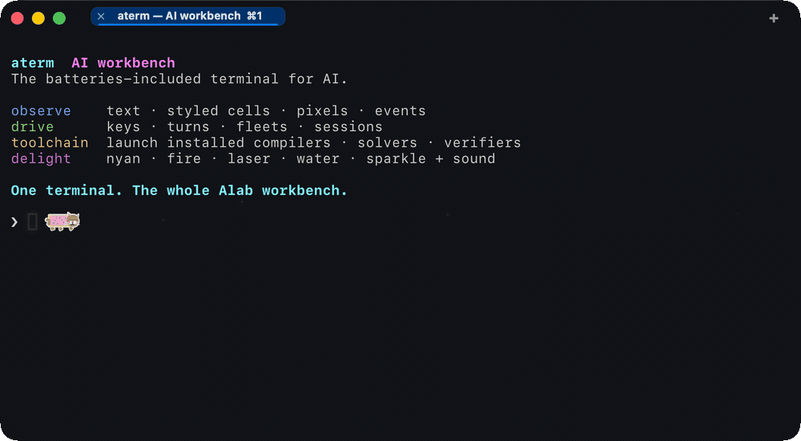
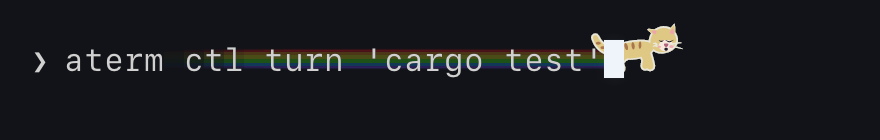

<!-- SPDX-License-Identifier: Apache-2.0 -->
<!-- Copyright 2026 Andrew Yates -->

<h1 align="center">aterm</h1>

<p align="center">
  <strong>The batteries-included terminal for AI.</strong><br>
  A GPU terminal for people, an authenticated control surface for agents, and
  the <a href="https://alab.systems">ALab</a> verification toolchain one
  command away.
</p>

<p align="center">
  <a href="https://github.com/alabsystems/aterm/releases"></a>
  <a href="LICENSE"></a>
</p>

<p align="center">
  <a href="#install">Install</a> ·
  <a href="#why-aterm">Why aterm?</a> ·
  <a href="#made-for-humans-and-agents">Humans + agents</a> ·
  <a href="#fun-is-a-feature">Fun</a> ·
  <a href="#the-alab-toolchain">Toolchain</a> ·
  <a href="#use-aterm-in-your-own-project">Embed it</a> ·
  <a href="#security-model">Security</a>
</p>

<p align="center">
  <picture>
    <source media="(prefers-reduced-motion: reduce)" srcset="assets/aterm-ai-workbench.png">
    
  </picture>
  <br><sub>Captured by aterm itself — <code>aterm ctl window</code> and <code>aterm ctl video</code>.</sub>
</p>

## Install

```sh
curl -fsSL https://raw.githubusercontent.com/alabsystems/aterm/HEAD/tools/install.sh | bash
```

On macOS the script downloads the newest app release from github.com, checks
its SHA-256 against the release manifest, verifies the Developer ID signature
and notarization, puts `aterm.app` in `/Applications` (or `~/Applications`) and
links the `aterm` command and its man pages under `~/.local`. The ALab
toolchain installs itself on first launch, with its progress in the app.

aterm starts Mac setup on first launch, and System State shows its progress.
Missing Command Line Tools, developer mode and the local network helper share
one administrator password request, which macOS owns. `aterm init --check
--json --only base.clt` reads the developer-tool setup row without changing
anything or asking for a password; `aterm init --help` explains its output.

Flags go after `bash -s --`; `--help` lists them (`--dry-run`, `--uninstall`,
`--no-toolchain`, …). `--no-toolchain` also writes `[packages] auto_install =
false` into `aterm.toml`, so the app skips the toolchain too. The toolchain
adds a marked block to an existing `~/.zshrc`, `~/.bashrc`, `~/.bash_profile`
or fish config; a deleted block stays deleted until `aterm pkg repair`.

The app is signed, notarized and universal, for macOS 11+; the Trust compiler,
its verifier backends and `clean` are published for Apple silicon only. Each
[release](https://github.com/alabsystems/aterm/releases) carries the signed
`aterm-appcast.toml` manifest and the app as `aterm-X.Y.0.dmg` (drag-install)
and `aterm-X.Y.0-mac.zip` (what the updater, the Homebrew cask and `install.sh`
use), each with a `.sha256` sidecar whose digest is also in the manifest.
`aterm.dmg` and `aterm-mac.zip` are the same bytes under permanent
`releases/latest/download/` names. To check a download and the installed app:

```sh
shasum -a 256 -c aterm-<version>.dmg.sha256
codesign --verify --strict --verbose=2 /Applications/aterm.app
spctl -a -t exec -vv /Applications/aterm.app   # must report source=Notarized Developer ID
```

### Linux

```sh
curl -fsSL https://alab.systems/install.sh | bash
```

The same installer, served by alab.systems. It installs the release's signed
`aarch64` or `x86_64` executable under `~/.local`, verifying the signature
chain and the executable before anything runs, and enrolls it for signed
updates. It needs curl, and Python 3.11+ with OpenSSL (Ed25519) for its
embedded verifier until a release publishes the static
`aterm-bootstrap-verify-<version>-linux-<arch>`, which it then pins by SHA-256
(read with `sha256sum` or `shasum`). Then run `aterm --window`. A raw
executable you download yourself is not enrolled for updates.

### Homebrew

```sh
brew install --cask alabsystems/tap/aterm
```

The cask installs the same signed app and declares `auto_updates`, so the app's
own updater keeps it current (`brew upgrade --cask --greedy aterm` makes
Homebrew do it instead). The `alab` cask is the same app under the toolchain's
name and conflicts with `aterm`.

### Staying current

Installed copies check, verify and install updates by themselves; on macOS
every window, tab and live shell survives the handoff. `aterm update status`
and Settings ▸ Software Update show where it stands; `aterm help update` has
the rest (Linux adds `enable`, `apply` and `rollback`). `[update] enabled =
false` stops background checks, and `[update] auto_apply = false` leaves
installing to you. Windows has no published build and no network updater.

### Build from source

This repository is a snapshot of the development line. It pins the Trust
toolchain (`rust-toolchain.toml`), which `aterm pkg install trust` provides on
Apple-silicon macOS, the one place the snapshot builds. With the Xcode Command
Line Tools:

```sh
git clone https://github.com/alabsystems/aterm.git && cd aterm
targo --unverified build --locked -p aterm --bin aterm
./target/debug/aterm --window
```

The tests also need `targo --unverified verify provision` (or `aterm init
--develop`). A source build is not the signed release and is not enrolled for
updates. The crates are not on crates.io; the crates.io `aterm`, the X11
`aterm` in MacPorts and the aterm.ai/aterm.io domains are unrelated projects.

## Why aterm?

aterm keeps the familiar PTY and adds a second, authenticated surface that
software can read and drive, while shells, TUIs, editors and agent CLIs still
see an ordinary terminal. Through it an agent can **observe** text, lossless
styled cells, cursor, modes, command blocks, session status and a timeline;
**drive** keys, paste, mouse, resize, selection, clipboard, tabs, menu actions
and Settings (signals are a separate operation, never faked keystrokes);
**coordinate** with event-driven `await`, `wait`, whole-turn settlement and
leases; **stream** subscriptions that mark gaps rather than hide them;
**capture** PNG frames, full-window shots, asciicast history and GPU video
(what aterm rendered, not what the display showed); and **measure** render and
input latency percentiles.

### One binary

| Invocation | Result | Control socket |
| --- | --- | --- |
| `aterm` in a TTY | Transparent PTY session | No |
| `aterm` with no TTY (a Finder launch), or `--window` | Terminal window | Yes |
| `aterm --headless` | The engine without a window | Yes |
| `aterm --session` | Force the PTY session in a pipe or CI | No |

The same binary answers the platform verbs (`ctl`, `pkg`, `fleet`, `update`,
`agents`, …), `help`, the diagnostics (`doctor`, `show-config`, …) and
managed-tool dispatch (`aterm --help` lists them); `aterm-ctl`, `atpkg`,
`abrew`, `agh`, `aterm-fleet`, `aterm-drive` and `amacs` (aterm's editor,
`aterm edit`) are symlinks onto it. <!-- From aterm_types::argv0::ALIASES. -->
Window and headless modes serve the control socket by default
(`--no-control-sock` turns it off) and fail closed when a secure socket cannot
be created.

## Made for humans and agents

Agents speak a local control protocol outside the PTY byte stream. What they
send enters through the same input path as keystrokes, and the keyboard never
routes through the agent, so a person can type at any time, even mid-turn.

When a window opens a session, aterm keeps a short primer current in the global
context file of each coding agent it finds (Claude Code, Codex CLI, agy,
OpenCode and Muse Code), installs its skills for all but agy, and sets a few
Claude Code defaults in `~/.claude/settings.json` where their keys are unset;
each `aterm init` keeps the primer and skills current too. The primer applies
only inside aterm (`TERM_PROGRAM=aterm`, `ATERM_CHILD=1`); keep your own rules
outside its markers. `aterm agents remove` uninstalls it,
`agents_auto_prime = false` stops it, and `aterm help agents` lists every file
and default.

Every spawned shell has `CLAUDE*`, `ANTHROPIC_*`, `COPILOT_*`, `CODEX_*`,
`ANTIGRAVITY_*`, `GEMINI_*`, `CURSOR_*`, `GROK_*`, `XAI_*`, `KIMI_*`,
`MOONSHOT_*`, `AI_*` and `_DEVTOOL_*` stripped. There is no MCP server: agents
use `aterm ctl` (stable session IDs, `@sid` routing across every same-user
instance, `@self`, and `aterm ctl survey` for what every session is doing),
`aterm conn` to wire one session to another, or the Rust library API.

### CLI tour

```sh
aterm --window -e htop          # a window running one command (-d <dir>, --hold, --shell)
aterm ctl text                  # plain visible rows
aterm ctl screen                # lossless styled-grid JSON
aterm ctl status                # phase, outcome, and confidence for this session
aterm ctl image frame.png       # the rendered frame as PNG; the reply names where it was saved
aterm ctl window shot.png       # the whole window with its native chrome (macOS)
aterm ctl turn 'git status'     # type, submit, settle, and return the screen
aterm ctl wait [<ms>]           # block until the running command completes (OSC 133)
aterm ctl metrics               # live render and latency counters
aterm ctl help text             # one verb's entry; bare `help` is the catalog

aterm ctl ls                                   # every session of every live instance
sid=$(aterm ctl spawn window=1 | cut -d' ' -f2)
aterm ctl "@$sid" turn 'make test'
aterm ctl "@$sid" await match 'result:'        # block until a regex appears (one token)
aterm ctl "@$sid" await agent idle,prompt,question,wall   # an agent peer's turn ended, a box waits, or a wall stops it
aterm ctl "@$sid" await log kind=program since=<log_seq> ep=<log_ep>   # a codex peer reported (seq/ep from status, read before typing)
aterm ctl subscribe "@$sid" events,cursor      # add screen,cells,bytes as needed
aterm ctl "@$sid" close
```

`await` takes one predicate (`idle <ms>`, `seq [<n>]`, `match <re>`,
`gone <re>`, `block`, `agent <word>`, `inbox since=<id>`, …) and an optional
`timeout=<ms>`; a timeout exits 124. Without `--sock`/`--pid` a call drives the
instance hosting your terminal, else the newest one.

## Fun is a feature

The default cursor is the **rainbow kitty**: a full-body cat that walks,
runs and pounces along your line over a rainbow line, with a typing sound on
macOS. It cheers a green build, sulks at a failed one and chases your mouse.
Type `sit`, `kitty jump` or `good kitty` and a space, and the cat does it
(`aterm help kitty`).

<p align="center">
  
</p>

`cursor_trail_style` takes `rainbow`, `phaser`, `fire`, `water`, `laser`
(shown as Lightning), `comet`, `sparkle`, `lumen`, `beam`, `classic` or `off`,
and `cursor_pet` takes `cat`, `dog`, `flying cat` or `off`: the cat or dog
walks beside any trail, or beside a plain cursor, and the flying cat flies in at
the head of the rainbow once typing gathers speed. Settings ▸ Cursor Styles previews each, and Settings ▸ Sound picks the typing sound. **Sparkle
Words**, TOML Toy Packs and **Matrix rain** (View ▸ Matrix Rain,
`aterm ctl rain toggle`) are purely visual: copied text and logs
read the exact bytes. `motion = reduced` (or the OS Reduce Motion setting)
stops governed animation, and `serious_mode` mutes every effect sound and hides
every decorative effect. On Windows decorative effects are opt-in.

## A real terminal underneath

Unicode grapheme clusters, wide and combining characters, bidi, the kitty
keyboard protocol, OSC 8 hyperlinks, OSC 133 shell marks (injected for zsh,
bash, fish and PowerShell), styled underlines, 24-bit colour, synchronized
output, bracketed paste, OSC 52, and sixel, iTerm2 and kitty graphics.
Scrollback is tiered (RAM, then LZ4; 100,000 lines by default), and predictive
local echo paints ahead of a slow shell.

Rendering is aterm's own GPU backends (Metal on macOS, OpenGL on Linux, Direct3D
11 on Windows), with the CPU rasterizer as fallback or `--cpu`, held to the same
frames by a parity suite. Tabs, splits and windows share one process and are
restored across relaunch; chords are rebindable under `[keybindings]`.
`aterm theme list` names the built-in themes, `theme = "dark:…,light:…"`
follows the OS appearance, `*.conf` files in a `themes` folder beside
`aterm.toml` (`~/.config/aterm/themes` on macOS and Linux) add your own
(`aterm help themes` has the format), `aterm theme import` converts another
terminal's, and
[`contrib/themes/GUIDE.md`](contrib/themes/GUIDE.md) is the guide to writing
and sharing one ([`contrib/themes/`](contrib/themes/README.md)).

## The ALab toolchain

aterm is the front door to ALab's verification toolchain: the `trust` compiler
(a Rust compiler that verifies what it compiles), the `ay` solver, the `ty`
specification checker, the `clean` theorem prover, and the `ny`/`nn`
neural-network tools.

```sh
aterm pkg install trust     # trustc, targo, tippy, …
aterm pkg install ay
aterm ay --help
aterm pkg list
```

`aterm <tool>` resolves against the managed store, never `$PATH`. On `$PATH`
the managed tools come last, `alab-<tool>` always names ALab's copy, and
`aterm pkg which <tool>` says which one runs. Inside an aterm tab `cargo`,
`rustc` and friends are rerouted to their Trust counterparts (`aterm help
reroute`; `--no-reroute` restores them). Packages ride the updater's trust
chain, verified before they are parsed and swapped in atomically with rollback.

## Use aterm in your own project

**Control a running terminal.** Every result in the [CLI tour](#cli-tour) has a
protocol equivalent; from Rust, `aterm-agent` wraps it as `CtlClient` and
`RelayClient`.

**Embed the engine** when your application owns the grid and renderer:

```toml
[dependencies]
aterm-core = { path = "../aterm/crates/aterm-core" }
```

```rust
use aterm_core::terminal::TerminalBuilder;

let mut terminal = TerminalBuilder::new().size(24, 80).build();
terminal.process(b"\x1b[32mhello from aterm\x1b[0m");
assert!(terminal.visible_content().contains("hello from aterm"));
```

For the browser (`wasm32-unknown-unknown`), `aterm-wasm` draws the engine with
the CPU rasterizer and `aterm-gpu-web` with `aterm-gpu` over WebGL2. Embedding
excludes the native window, the control socket and the sound palette. The
crates are pre-1.0.

## Security model

The control surface can read terminal output and inject input, so aterm treats
it as privileged:

- Every control-enabled window or headless instance mints a fresh per-launch
  capability token, and every connection must present it.
- Unix runtime directories, sockets, and tokens are user-private, and every
  connection verifies the peer's user ID. Windows uses a hardened user-private
  ACL plus the launch token; SYSTEM and platform administrators remain
  privileged.
- Scoped capabilities can grant a single kind of operation on a single session
  without handing over the instance's owner token; owner-only verbs stay
  owner-only.
- The one network door is the fleet listener (`[fleet] listen`, set by `aterm
  fleet init` and `join`). It accepts loopback, private and link-local IPv4
  addresses only, admits peers that prove the shared fleet secret, and answers
  reads at the configured `[fleet] allow` level, never as the owner. Driving needs
  `allow = "drive"` and a grant (`aterm fleet allow drive --from <node>` or
  `--all`) checked against each peer's node key, and goes only as far as the
  driven machine's fleet access lets it. A local Take Over always wins
  (`aterm help fleet`).
- Fleet access is each machine's own ceiling on what a granted member may do
  to it, and starts at Read Only: other members read its sessions, and none
  starts a job, sends a message or types into one. Its person raises it at
  that machine, with the lock in its menu bar or `aterm fleet access write`
  (the sessions already there, no new tabs) or `full`; no other machine can.
  Leaving a fleet, or coming to hold another fleet's key, puts it back to Read
  Only.
- On the trusted ALab LAN, setup automatically joins the vault, materializes
  available shared credentials and syncs fleet membership. A synced join grants
  drive access to every member by default. Being on this LAN is the admission
  authority; no per-machine approval is required. Members can read one
  another's sessions, and drive those of a machine whose person raised its
  fleet access. Explicit sharing Off and lower access choices remain in
  force, and macOS permissions remain separate OS decisions.
- Capture paths are confined to server-managed runtime directories.
- Browser automation never adds Chromium's `--no-sandbox` flag. On Linux, run
  it as an unprivileged user so Chromium can keep its sandbox enabled.
- Terminal-side powers other programs could abuse — window operations,
  notifications, kitty-graphics reads of host files, OSC 52 clipboard reads
  (`allow_osc52_query`) — are off by default, and a multi-line paste into a
  shell without bracketed paste asks first. Palette changes (OSC 4/21) are
  allowed unless `allow_palette_reconfigure = false`.

**Release trust** — for the macOS and Linux app updaters and the toolchain
package index — is anchored by a **paper master key** that exists on no
computer. It signs only a machine roster: one signing key per publishing
machine, plus the deny-list that withdraws one. A release must carry a
master-signed roster, a manifest signed by a rostered, unrevoked machine, a
forward-only build number and a matching artifact digest. macOS additionally
verifies a Developer ID signature pinned to one Team ID, plus notarization;
native Linux verifies the exact ELF target, size and compiled identity before
replacement. The 64-byte `.sig` assets are those detached Ed25519 signatures
(`aterm-appcast.toml.sig` over the manifest, `aterm-machines.toml.sig` over the
roster). A stolen machine key is therefore revocable by an authority the
thief does not hold, and a revocation retracts even an already-staged build.
What a build trusts is a committed constant, never an environment variable —
`PAPER_MASTER_PUBKEYS` in `crates/aterm-update-core/src/pins.rs`, reproduced
here so it can be checked from more than one place:

```text
paper master public key (Ed25519, base64):
DtiLfpk0iUSrK1/LkyIVf+4C2eGjD2Myf4Sr/FCoMPQ=
```

The macOS installer roots trust in the Apple Developer ID chain (Team
`A66A9P66Z7`); the installed updater also verifies the Ed25519 chain. The Linux
installer requires the master-to-roster-to-manifest Ed25519 chain itself.

**Containment** is chosen at launch: `--containment <mode>` takes `user` (the
default), `safety` or `containment`, and `--sandbox` is shorthand for the last.
`containment` wraps the shell in the macOS sandbox and fails closed: no
network, writes only to the temp directories, `/dev` and the shell's history,
no credential stores, private data or debugger attach, and no Mach lookup but
user and group queries, so `open`, `osascript`, `pbcopy` and the keychain do
nothing (launchd registers no job for it, but still restarts, unloads,
disables or enables your own jobs when asked, aterm's vault agent included). A
contained tab gets no brokered clipboard, Kitty file reads or notifications,
whatever the `allow_*` keys say. Linux and Windows have no OS sandbox, so there
`--sandbox` refuses to start. `safety` sets resource limits with no OS sandbox
on every platform, soft on macOS and Linux (the shell can raise them);
`containment` sets them hard (`aterm help containment`).

Rewind keeps each pane's recent screens in memory only (`temporal_recording`,
on by default), pixel video starts only when requested, and each session keeps
a bounded in-memory asciicast history. Granting terminal control grants the
authority of the programs running in that session.

Report suspected vulnerabilities through [SECURITY.md](SECURITY.md), never a
public issue.

## Verification and performance evidence

Bounded protocols and state machines are Rust-derived models that an embedded
exhaustive checker verifies on every test run, tied to shipping code by
conformance tests. The Apple-silicon slice of each release is compiled by the
Trust toolchain. Not on yet: no release runs the Trust proof lane; releases
compile with Trust's unverified lane. This is a known gap, not a policy. The
model checks above cover named, bounded contracts, not the whole emulator,
renderer or OS. There is no hosted CI; every release runs `targo --unverified verify
release` first. [CONTRIBUTING.md](CONTRIBUTING.md) says what you can run here.

aterm makes no aggregate performance claim; `aterm ctl metrics` measures render
and input latency on your own workload.

## Help and configuration

```sh
aterm help                   # the manual (in an aterm window's tab: the agent brief)
aterm --window --help        # window options, keys, config keys
aterm help introspection     # the control-verb catalog, offline
aterm doctor
aterm --window --validate-config
```

Configuration is read from `$XDG_CONFIG_HOME/aterm/aterm.toml`, else
`%APPDATA%\aterm\aterm.toml` on Windows and `~/.config/aterm/aterm.toml`
elsewhere. Launch flags override it; no environment variable sets a key. The
window applies supported changes without a restart, and Settings ▸ Manual ▸
Open aterm.toml opens the file in aterm's editor.

aterm contains no telemetry. By default it goes online for the app update check
and the toolchain package pass, which reads GitHub and each agent CLI's own
vendor: downloads.claude.ai (Claude Code), releases.openai.com (Codex CLI),
antigravity-cli-auto-updater-974169037036.us-central1.run.app and
storage.googleapis.com (Antigravity CLI), api.meta.ai and
lookaside.facebook.com (Muse Code, macOS only), registry.npmjs.org and
storage.googleapis.com (Grok Build), and cdn.kimi.com (Kimi Code). aterm never
mirrors or bundles an agent CLI, and only the window and interactive sessions
run the pass; explicit network commands always do their work. `[packages]
exclude` drops a program from it, and `[packages] enabled = false` stops it.

On macOS aterm also turns Universal Control off for this Mac
(`[machine] universal_control = "leave"` stops that; `aterm pkg machine` prints
the line that turns it back on), installs Rosetta 2 on Apple silicon when it is
missing (`[machine] rosetta = false` stops that), and once a day removes the
Rust build-cache folders under `~/Library/Caches/aterm/.ubd/cargo-build.noindex`
that nothing builds into any more. If builds stall while macOS checks each new
program, `aterm doctor`'s `devtools:` row says so: adding aterm under System
Settings ▸ Privacy & Security ▸ Developer Tools ends those checks, but also
skips macOS's first-run malware scan for everything run in aterm, so the choice
is yours. Bare `aterm doctor` opens that page when aterm is not on the list and
moves stale copies of aterm to the Trash; `aterm doctor --read-only` changes
nothing.

## Community and license

Focused fixes are welcome — see [CONTRIBUTING.md](CONTRIBUTING.md).
[PUBLICATION.md](PUBLICATION.md) describes this snapshot's boundary and
[VERSIONING.md](VERSIONING.md) the one `MAJOR.MINOR.0` version.

Unless a file says otherwise, aterm is licensed under the
[Apache License 2.0](LICENSE). MIT-licensed components use
[LICENSE-MIT](LICENSE-MIT); third-party material keeps its own terms
([NOTICE](NOTICE)).
