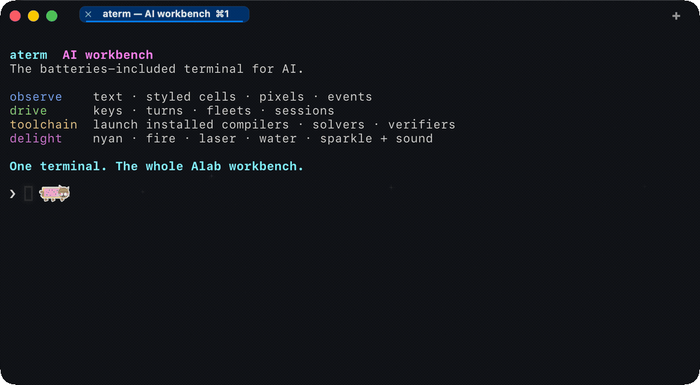
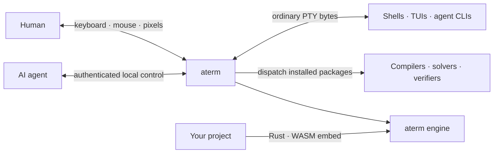
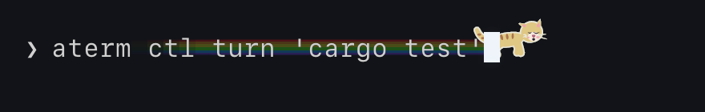

<!-- SPDX-License-Identifier: Apache-2.0 -->
<!-- Copyright 2026 Andrew Yates -->

<h1 align="center">aterm</h1>

<p align="center">
  <strong>The batteries-included terminal for AI.</strong><br>
  A real GPU terminal for people, an authenticated control surface for agents,
  the <a href="https://alab.systems">ALab</a> verification toolchain one
  command away — and a cat.
</p>

<p align="center">
  <a href="https://github.com/alabsystems/aterm/releases"></a>
  <a href="LICENSE"></a>
</p>

<p align="center">
  <a href="#install">Install</a> ·
  <a href="#why-aterm">Why aterm?</a> ·
  <a href="#made-for-humans-and-agents">Humans + agents</a> ·
  <a href="#fun-is-a-feature">Fun</a> ·
  <a href="#the-alab-toolchain">Toolchain</a> ·
  <a href="#use-aterm-in-your-own-project">Embed it</a> ·
  <a href="#security-model">Security</a>
</p>

<p align="center">
  <picture>
    <source media="(prefers-reduced-motion: reduce)" srcset="assets/aterm-ai-workbench.png">
    
  </picture>
  <br><sub>Captured by aterm itself — <code>aterm ctl window</code> and <code>aterm ctl video</code>.</sub>
</p>

## Install

```sh
curl -fsSL https://raw.githubusercontent.com/alabsystems/aterm/HEAD/tools/install.sh | bash
```

**The macOS app is a ~40 MB download. aterm opens immediately; the ALab toolchain installs itself
on first launch with live progress** — each program downloads individually and
resumably, only the builds for your machine, visible end to end in the app.

On macOS the script downloads the newest app release from github.com (no
credential, no API request), checks its SHA-256 against the release manifest,
verifies the app's Developer ID signature and notarization, puts `aterm.app` in
`/Applications` (or `~/Applications`), and links the `aterm` command and its man
pages under `~/.local`. Flags: `--dry-run` prints the whole plan and writes
nothing; `--uninstall` reverses everything it installed; `--no-path` skips the
installer's own PATH block; `--no-toolchain` excludes the toolset and writes
`[packages] auto_install = false` into `aterm.toml` (never over a value already
there), so the app's first launch leaves it alone too — a machine that already
runs the toolset keeps updating it, but gains a new default-set member only from
`aterm pkg install --default-set` (`aterm help pkg`). The toolset adds a marked
block to an existing `~/.zshrc`, `~/.bashrc`, `~/.bash_profile` or fish config;
delete it and it stays deleted (`aterm pkg repair` puts it back).

aterm ships for macOS 11+ as a signed, notarized universal app (Apple silicon
and Intel), from
[github.com/alabsystems/aterm/releases](https://github.com/alabsystems/aterm/releases).
The Trust compiler, its verifier backends and `clean` are published for Apple
silicon only, so on an Intel Mac the first-launch toolchain installs without them.
The channel carries two kinds of cut: **app releases** ship the containers
below plus the signed `aterm-appcast.toml` manifest, and **source releases**
carry only a signed source manifest — the installer and the in-app updater elect
the newest app release and skip source cuts.
Every macOS app release is the same app in two containers:

- **`aterm-X.Y.0.dmg` — the download.** The signed, notarized app
  alone, as a drag-install image: drag `aterm.app` into Applications.
- **`aterm-X.Y.0-mac.zip` — the same app, zipped.** The container the
  in-app updater, the Homebrew cask, and `install.sh` consume.

An air-gapped Mac can install the app from the DMG; the toolchain always comes
from the network.

Every app release also carries the permanent names `aterm.dmg` and
`aterm-mac.zip`, so `releases/latest/download/aterm.dmg` and
`releases/latest/download/aterm-mac.zip` always fetch the newest app. Every
container has a `.sha256` sidecar whose digest also appears in that release's
`aterm-appcast.toml`. With the sidecar beside the asset, and the app in place:

```sh
shasum -a 256 -c aterm-<version>.dmg.sha256
codesign --verify --strict --verbose=2 /Applications/aterm.app
spctl -a -t exec -vv /Applications/aterm.app
```

The last must report `source=Notarized Developer ID`.

### Linux

The native installer supports `aarch64-unknown-linux-gnu` and
`x86_64-unknown-linux-gnu` when the channel publishes their signed raw executables,
named `aterm-<version>-linux-aarch64` and `aterm-<version>-linux-x86_64`.
It requires Python 3.11+, curl and OpenSSL with Ed25519 support. It verifies the
committed master key, current signed machine roster, appcast, exact digest,
size, ELF target and executable identity before the runtime installs and
enrolls the app in one locked, recoverable transaction. Existing sessions are
never restarted. The installed command lives under `~/.local`:

```sh
aterm --window
aterm update status
```

A downloaded raw file does not update itself; use the installer, which checks
that the executable starts on your system before replacing a copy, and says so
when the channel has no Linux build for your architecture. On Linux, `aterm
update --help` lists `enable`, `apply` and `rollback`.

### Homebrew

The cask route installs the same signed, notarized app from the release's
`mac.zip`, via ALab's tap:

```sh
brew install --cask alabsystems/tap/aterm
```

The cask declares `auto_updates`, because the installed app keeps itself current
through its own verified updater (see [Staying current](#staying-current));
`brew upgrade --cask --greedy aterm` makes Homebrew do it instead.
`brew install --cask alabsystems/tap/alab` lands the same app under the
toolchain's name — install one or the other, not both.

### Staying current

Installed copies update themselves: the app checks the channel in the background,
verifies the new build and swaps it in at a quiet moment — on macOS every window, tab and
live shell survives the handoff. Settings ▸ Software Update and `aterm update status`
show what is staged. `[update] enabled = false` stops background checks;
`[update] auto_apply = false` stages but leaves applying to you. Windows has no updater
and no published build; building there needs the Trust toolchain for Windows, which is
not published yet (see [Build from source](#build-from-source)).

### Build from source

This repository is a snapshot of the development line and pins the Trust toolchain
(`rust-toolchain.toml`); install aterm and atpkg installs Trust (`aterm pkg install
trust`). atpkg ships Trust for Apple-silicon macOS only, so that is where this snapshot
builds today. With the Xcode Command Line Tools:

```sh
git clone https://github.com/alabsystems/aterm.git && cd aterm
targo --unverified build --locked -p aterm
./target/debug/aterm --window
```

The crates are not on crates.io. A source build is a real aterm, not the signed release,
and is not enrolled for updates. (The crates.io `aterm`, the X11 `aterm` in MacPorts and
the aterm.ai/aterm.io domains are unrelated projects.)

## Why aterm?

Most terminals are excellent human interfaces. aterm keeps the familiar PTY and adds a
second, authenticated surface software can understand — text, styled cells, pixels,
events, sessions, input, synchronization and live metrics — so a person types normally
while an agent observes structured state, drives a turn, waits for a real transition or
captures the rendered result. Shells, TUIs, editors and agent CLIs still see an ordinary
terminal.



| Battery | What aterm adds | Boundary |
| --- | --- | --- |
| **Observe** | Plain text, lossless styled cells, cursor, modes, command blocks, session status, a lifecycle timeline, full-history search | Window and headless modes only |
| **Drive** | Text, keys, paste, mouse, focus, resize, selection, clipboard, tabs, menu actions, Settings | Signals are a separate operation, never faked keystrokes |
| **Coordinate** | Event-driven `await`, `ready`, `wait`, whole-turn settlement, drive leases | `turn` waits for the screen to settle; `wait` needs OSC 133 marks |
| **Stream** | `screen`, `cursor`, `cells`, `bytes`, `events`, `mail`, `sessions` subscriptions, fleet-wide NDJSON | Gaps are marked, never hidden |
| **Capture** | PNG frames, full-window shots with native chrome (macOS), asciicast history, opt-in temporal replay, GPU video | What aterm rendered, not what the display showed |
| **Measure** | Render, frame, input and present counters with percentiles and startup phases | Software-side counters |
| **Extend** | Themes, typography, wallpaper, Trail Packs, Toy Packs, keybindings, the engine source | Path dependencies only; no API stability yet |
| **Delight** | The rainbow kitty pet, per-program cats, Robi, cursor trails, Sparkle Words, Matrix rain, a typing-sound synth | Synth audio is macOS-only |

### One binary

| Invocation | Result | Control socket |
| --- | --- | --- |
| `aterm` in a TTY | Transparent PTY session | No |
| `aterm` with no TTY (a Finder launch), or `--window` | Terminal window | Yes |
| `aterm --headless` | The engine without a window | Yes |
| `aterm --session` | Force the PTY session in a pipe or CI | No |

The same binary answers `ctl`, `conn`, `pkg`, `fleet`, `drive`, `link`, `fabric`,
`update`, `agents`, `harness`, `keeper`, `new-tab`, `new-window`, `split-pane`, `ship`
(source checkouts), `help`, the diagnostic words
(`doctor`, `show-config`, `list-themes`, …) and managed-tool dispatch. `aterm-ctl`,
`atpkg`, `aterm-fleet` and `aterm-drive` are symlinks onto it. Control is on by default
in window and headless modes (`--no-control-sock` turns it off) and fails closed if a
secure socket cannot be created.

## Made for humans and agents

Agents speak a local control protocol outside the PTY byte stream; what they send enters
through the same input path as a person's keystrokes, and the person's keyboard never
routes through the agent, so a human can type at any time, even mid-turn.

Each time a window opens a session, aterm keeps a short primer current in the global
context file of every coding agent it finds — Claude Code, Codex CLI, Gemini CLI,
OpenCode (`~/.claude/CLAUDE.md`, `~/.codex/AGENTS.md`, …). Claude Code also gets four
bundled skills — `drive-aterm`, `supervise-agent`, `rust-in-aterm` and `aterm-fabric` —
and the other agents get `aterm-fabric` as a command. The brief activates only inside
aterm (`TERM_PROGRAM=aterm`, `ATERM_CHILD=1`; its Rust and peer-messaging notes gate on
the toolchain and the fabric), where `aterm help` prints the agent brief with the
caller's session ID filled in. Rules of your own go outside its markers. `aterm agents`
shows status, `aterm agents remove` uninstalls, `agents_auto_prime = false` stops it.

- **Env hygiene is unconditional.** Every spawned shell has `CLAUDE*`, `ANTHROPIC_*`,
  `COPILOT_*`, `CODEX_*`, `CURSOR_*`, `AI_*` and `_DEVTOOL_*` stripped, and a window's
  shell gets a fresh session identity.
- **There is no MCP server, by design.** The integration surfaces are the CLI
  (`aterm ctl`, `conn`, `drive`, `fleet`) and the Rust library API.
- **A session fabric**: stable IDs, `@sid` routing across every same-user instance,
  `@self`, per-session `status` and `timeline`, settable `meta` (`role`, `attention`),
  turn leases, multi-session subscriptions, `aterm fleet events` / `aterm fleet exec`
  over one descriptor, and `aterm conn` to wire one session to watch and type into
  another.

### CLI tour

```sh
aterm --window -e htop          # a window running one command (-d <dir>, --hold, --shell)
aterm ctl text                  # plain visible rows
aterm ctl screen                # lossless styled-grid JSON
aterm ctl status                # phase, outcome, and confidence for this session
aterm ctl image frame.png       # the rendered frame as PNG; the reply names where it was saved
aterm ctl window shot.png       # the whole window with its native chrome (macOS), saved the same way
aterm ctl turn 'git status'     # type, submit, settle, and return the screen
aterm ctl wait [<ms>]           # block until the running command completes (OSC 133)
aterm ctl metrics               # live render and latency counters
aterm ctl help text             # one verb's entry; bare `help` is the catalog

aterm ctl ls                                   # every session of every live instance
sid=$(aterm ctl spawn window=1 | cut -d' ' -f2)
aterm ctl "@$sid" turn 'make test'
aterm ctl "@$sid" await match 'result:'        # block until a regex appears (one token)
aterm ctl "@$sid" await agent idle,prompt,question,wall   # a coding-agent peer: block until the server's verdict says its turn is over, a box waits, or a wall stops it (latched)
aterm ctl subscribe "@$sid" events,cursor      # targets follow the verb here; add screen,cells,bytes as needed
aterm ctl "@$sid" close
```

`await` takes one predicate (`idle <ms>`, `seq [<n>]`, `match <re>`, `gone <re>`,
`block`, `agent <word>`, `inbox since=<id>`, …) and an optional `timeout=<ms>`;
`await seq <n> timeout=0` is a cheap "did anything change?", and a timeout exits 124.
Without `--sock`/`--pid` a call drives the instance hosting your terminal, else the
newest instance; a private instance binds its own path with `--control-sock`. Every help
listing is generated from the one verb table the server answers from.

## Fun is a feature

The default cursor is the **rainbow kitty pet**: a full-body cat that walks, runs and
pounces along your line on a banded rainbow ribbon, with a music-box typing sound on
macOS. It cheers a green build, sulks at a failed one, chases your mouse, and purrs when
stroked. Every launch generates a new kitty, and any program that holds the foreground
earns its own cat; View ▸ Favourite This Kitty pins one.

<p align="center">
  
</p>

- **Trails**: `rainbow kitty pet` (also `kitty`), `rainbow kitty flying`, `rainbow dog
  pet`, `phaser`, `comet`, `lumen`, `sparkle`, `fire`, `laser`, `water`, `beam`,
  `classic`, `off` — or a TOML Trail Pack. Settings ▸ Cursor &
  Motion picks the typing sound.
- **Robi**, a tip-sharing helper robot (`robi = true`).
- **Sparkle Words** give typed words animated ink; TOML Toy Packs add your own. Purely visual: copied text and logs read exact bytes.
- **Matrix rain** in empty cells (View ▸ Matrix Rain, `aterm ctl rain toggle`).

`motion = reduced` (or the OS Reduce Motion setting) stops governed animation;
`serious_mode` mutes every effect sound and hides every decorative effect in one switch.
On Windows decorative effects are opt-in.

## A real terminal underneath

Unicode grapheme clusters, wide and combining characters, bidi, the kitty keyboard
protocol, OSC 8 hyperlinks, OSC 133 shell marks (injected for zsh, bash, fish and
PowerShell), styled underlines, 24-bit colour, synchronized output, bracketed paste,
OSC 52, and sixel, iTerm2 and kitty graphics. Scrollback is tiered (RAM, LZ4, zstd;
100,000 lines by default); predictive local echo paints ahead of a slow shell; box
drawing and Powerline glyphs are generated from cell geometry; an idle event loop parks.

Rendering is aterm's own Metal backend on macOS and wgpu elsewhere, with the CPU
rasterizer as fallback or `--cpu`, held to the same frames by a parity suite. Tabs,
splits and windows share one process and are restored across relaunch; Settings
(Cmd-,), Markdown files and an editor open as tabs; Cmd-F searches scrollback by regex;
Shift-Cmd-P is the command palette; chords are rebindable under `[keybindings]`. Twelve
themes are built in, `theme = "dark:…,light:…"` follows the OS, and
`~/.config/aterm/themes/*.conf` adds your own. Linux builds publish an AccessKit tree for
screen readers.

## The ALab toolchain

aterm is the front door to ALab's verification toolchain — the `trust` compiler (a Rust
compiler that verifies what it compiles), the `ay` solver, the `ty` specification
checker, the `clean` theorem prover, and the `ny`/`nn` neural-network tools:

```sh
aterm pkg install trust     # trustc, targo, tippy, …
aterm pkg install ay
aterm ay --help
aterm pkg list
```

`aterm <tool>` resolves against the managed store, never `$PATH`. On `$PATH` the managed
tools come last, `alab-<tool>` always names ALab's copy, and `aterm pkg which <tool>`
says which one runs. Inside an aterm tab `cargo`, `rustc` and friends are rerouted to
their Trust counterparts (`aterm help reroute`; `--no-reroute` restores them). Packages
ride the updater's trust chain: verified before parsing, tree-hashed against the signed
manifest, swapped in atomically with rollback.

## Use aterm in your own project

**Control a running terminal.** Every result in the [CLI tour](#cli-tour) has a protocol
equivalent; from Rust, `aterm-agent` wraps it as `CtlClient`, `RelayClient` and `Turn`.

**Embed the engine** when your application owns the grid and renderer:

```toml
[dependencies]
aterm-core = { path = "../aterm/crates/aterm-core" }
```

```rust
use aterm_core::terminal::TerminalBuilder;

let mut terminal = TerminalBuilder::new().size(24, 80).build();
terminal.process(b"\x1b[32mhello from aterm\x1b[0m");
assert!(terminal.visible_content().contains("hello from aterm"));
```

Beyond Rust: two WebAssembly crates target `wasm32-unknown-unknown` —
`aterm-wasm` (engine plus CPU rasterizer into a canvas) and `aterm-gpu-web`
(engine plus wgpu over WebGL2).
[Orca ALab Edition](https://github.com/alabsystems/orca-alab) is the reference
integration. Embedding excludes the native window, the control socket and the sound
palette. The crates are pre-1.0.

## Security model

The control surface can read terminal output and inject input, so aterm treats
it as privileged:

- Every control-enabled window or headless instance mints a fresh per-launch
  capability token, and every connection must present it.
- Unix runtime directories, sockets, and tokens are user-private, and every
  connection verifies the peer's user ID. Windows uses a hardened user-private
  ACL plus the launch token; SYSTEM and platform administrators remain
  privileged.
- Scoped capabilities can grant a single kind of operation on a single session
  without handing over the instance's owner token; owner-only verbs stay
  owner-only.
- Network driving is opt-in: a TLS 1.3 relay with a pinned certificate
  fingerprint and channel-bound tokens, never the default control path.
- Capture paths are confined to server-managed runtime directories.
- Terminal-side powers other programs could abuse — window operations,
  notifications, palette reconfiguration, kitty-graphics reads of host files,
  OSC 52 clipboard reads — are opt-in and off by default (clipboard reads answer
  only under `allow_osc52_query = true`, and an authorized query is always
  answered rather than left hanging), and a multi-line paste into a shell without
  bracketed paste asks first.

**Release trust** — for the macOS/Linux app updaters and the toolchain package index —
is anchored by a **paper master key** that exists on no computer. It signs only a
machine roster: one signing key per publishing machine, plus the deny-list that
withdraws one. A release must carry a master-signed roster, a manifest signed by
a rostered, unrevoked machine, a forward-only build number and a matching
artifact digest. macOS additionally verifies a Developer ID signature pinned
to one Team ID plus notarization; native Linux verifies the exact ELF target,
size and compiled identity before replacement. The
64-byte `.sig` assets are those detached Ed25519 signatures
(`aterm-appcast.toml.sig` over the manifest, `aterm-machines.toml.sig` over the
roster). A stolen machine key is therefore revocable by an authority the thief
does not hold, and a revocation retracts even an already-staged build. What a
build trusts is a committed constant, never an environment variable —
`PAPER_MASTER_PUBKEYS` in `crates/aterm-update-core/src/pins.rs`, reproduced here
so it can be checked from more than one place:

```text
paper master public key (Ed25519, base64):
DtiLfpk0iUSrK1/LkyIVf+4C2eGjD2Myf4Sr/FCoMPQ=
```

On macOS bootstrap roots trust in the Apple Developer ID chain (Team
`A66A9P66Z7`), and the installed updater additionally verifies this Ed25519
chain. The Linux bootstrap itself requires the committed master-to-roster-to-
manifest Ed25519 chain. Neither Linux installation nor automatic updates falls
back to a checksum-only legacy tarball.

Containment is a launch-time choice: `--containment <mode>` with modes `master`,
`user` (default), `safety`, and `containment`. `--sandbox` is shorthand for the
last and wraps the shell in the macOS sandbox: no network, writes only under
the temp directories (`$TMPDIR`, `/private/tmp`) and `/dev` plus the shell's
history file, no reads or writes of credential stores or private data
directories, no debugger attach (no task port but a process's own), and no
mach service lookup but the user and group queries (so `open`, `osascript`,
`pbcopy` and the keychain do nothing from inside; launchd, which needs no
lookup, answers a contained caller by its own policy), failing closed if the
wrapper is missing. The working directory
and `$HOME` are read-only there, so a contained tool that builds a project
builds a copy under `$TMPDIR`. Linux and Windows have no OS sandbox, so there `--sandbox`
refuses to start and names the gap rather than run a shell unconfined. `safety`
is hardened resource limits with no OS sandbox, on every platform.

Temporal recording is off by default, and pixel video starts only when requested.
Each session retains a bounded in-memory asciicast output history. Granting
terminal control grants the ability to act with the authority of programs running
in that session.

Report suspected vulnerabilities through [SECURITY.md](SECURITY.md), never a
public issue.

## Verification and performance evidence

Bounded protocols and state machines are written once as Rust-derived models —
hundreds of them — that generate both a checkable specification and an executable
interpreter. An embedded exhaustive checker verifies their invariants,
deadlock-freedom, and transitions on every test run (a handful of
function-valued models can only be checked by `ty`, and say so); where `ty` is
installed the same obligations get a second, independent check, and `ay`
re-checks the development line's hand-encoded SMT certificate bundles. A missing
tool prints a prominent "did not run" notice rather than passing silently, and a
few certificate gates fail outright instead. Conformance tests project real
subsystem state back onto the models so the specs stay tied to shipping code; a
model with no such tie only proves something about itself, and the repository
labels those.

Shipped bugs get promoted into that discipline rather than just patched: the
updater's quarantine memo is one contract binding its writer to its reader,
checked by the interpreter and by `ty`, bound to the real code by a conformance
test, with the original crash-loop replayed as a negative control.

The development line — and the Apple-silicon slice of every release — is compiled
by the Trust toolchain (`trustc`/`targo`), but in-compilation verification is not
yet enabled workspace-wide, so "compiled by a verifying compiler" is not
"verified": that campaign ratchets crate by crate. The public snapshot pins the
same Trust toolchain and carries the embedded exhaustive checker, the conformance,
property and fuzz tests and the CPU/GPU parity suites (the `ay` bundles stay
internal). These prove or test named, bounded contracts — not the whole emulator,
renderer, or OS.
The development line gates every merge on a local verification run (there is
no hosted CI), and the release cutter re-runs the temporal-safety checks before
it claims a build number. Those gate scripts live in the development line, not
in this snapshot; [CONTRIBUTING.md](CONTRIBUTING.md) says what you can run here.

aterm makes no aggregate performance claim: no head-to-head has been run on a
shipped build under a protocol fit to publish. `aterm ctl metrics` measures render
and input latency on the workload that matters to you.

## Help and configuration

```sh
aterm help                   # the manual (in an aterm window's tab: the agent brief)
aterm --window --help        # window options, keys, config keys
aterm help introspection     # the control-verb catalog, offline
aterm doctor
aterm --window --validate-config
```

Configuration is loaded from `$XDG_CONFIG_HOME/aterm/aterm.toml`, falling back to
`%APPDATA%\aterm\aterm.toml` on Windows and `~/.config/aterm/aterm.toml`
elsewhere. Explicit flags override the file. No `ATERM_*` or `ATPKG_*` variable is a
setting in a shipped aterm — the few it reads are what it hands its own children —
while the standard ones (`$XDG_CONFIG_HOME`, `$HOME`, `$SHELL`) keep their usual
meaning. The window watches the configuration and applies supported
changes without a restart, and Settings ▸ Manual opens the file in the native
editor.

aterm contains no telemetry. By default it goes online for two things only: the
app update check (eligible macOS or enrolled Linux installs) and the toolchain
package update pass (GitHub, plus downloads.claude.ai and releases.openai.com for
Claude Code and Codex CLI). When that pass installs a new Claude Code or Codex CLI
you have used before, aterm runs it once in the background so it refreshes your
account's model list. `[packages] enabled = false` stops the pass and that run
(a build you install by hand still gets the run). The window and ordinary
interactive sessions run these checks; noninteractive helpers and introspection
harnesses do not, though explicit network commands still do their work.
Descriptive tab titles use a local summarizer unless you opt into a remote
provider.

On macOS aterm also turns Universal Control off for this Mac by default. In
`aterm.toml`, `[machine]` `universal_control = "leave"` stops it (Settings ▸
Security); `aterm pkg machine` prints the line that turns it back on.

Code goes in `~/Developer`: `aterm doctor` names the git checkouts under your home
that are not there, `aterm pkg devroot move --all` moves them a repository at a time
(refusing any with uncommitted work or a program running in it), and its `spotlight:`
row measures whether Spotlight skips `~/Developer` — add the folder once in System
Settings ▸ Spotlight ▸ Search Privacy, the one way Apple documents to keep a folder out
of the index.

## Community and license

Focused fixes are welcome — see [CONTRIBUTING.md](CONTRIBUTING.md).
[PUBLICATION.md](PUBLICATION.md) describes this snapshot's boundary and
[VERSIONING.md](VERSIONING.md) the one `MAJOR.MINOR.0` version.

Unless a file says otherwise, aterm is licensed under the [Apache License 2.0](LICENSE).
MIT-licensed components use [LICENSE-MIT](LICENSE-MIT); third-party material keeps its
own terms ([NOTICE](NOTICE)).
