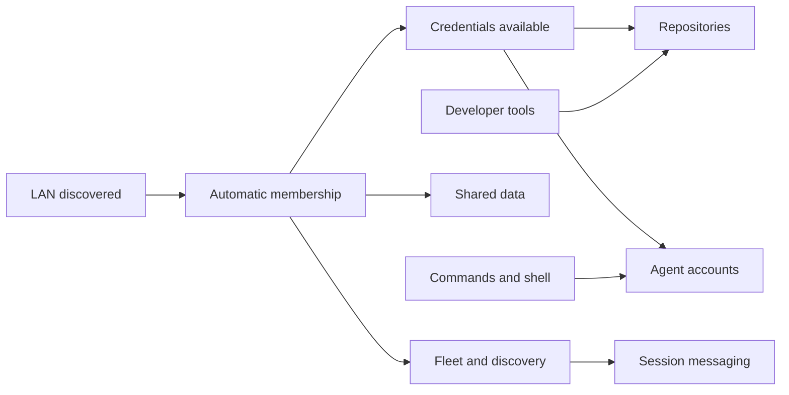

# LAN-first initialization

## Current decision

Everything is selected, on, and active by default on this LAN. Joining does not require an Allow button, a phrase, or the old `[join] open` opt-in. New channels, internet operation, a new server, and additional protection modes are outside this change.

## Audit findings

The existing dependency engine is usable. `aterm-converge::Item::after` expresses dependencies, `order` checks for missing edges and cycles, and the runner blocks dependent work until prerequisites verify. The problem is the surrounding orchestration and inconsistent status policies.

| Finding | Source | Change |
| --- | --- | --- |
| Default LAN approval still requires the old open-policy flag | `aterm-secrets/src/client.rs`, `auto_approve_listed_in` | Admit a server-observed LAN request to the pinned default ALab network without the opt-in. Keep existing explicit revocations. |
| A pending join is reposted only once an hour | `client.rs`, `REASK` | Repost every 30 seconds. Preserve the in-flight join's five-minute grace so a subscriber cannot interrupt a password exchange for another vault. |
| Default unconfigured CLI join skips without a terminal or asks for a password | `init_secrets.rs`, `items` | Reuse unattended selected-vault setup for the default LAN path. |
| Background and agent init omit workstation defaults | `aterm-machines/src/init.rs`, `groups` | Select the same defaults for all launchers in the account's local graphical session. |
| Missing default GitHub credentials read as “not applicable” | `init_github/native.rs`, `Block::probe` | Keep repository setup pending. |
| Waiting admission, permission and deferred workstation rows count as complete | `init.rs`, `counts` and `status` | Completion requires verification; waiting returns 75, required OS action 77. |
| CLI tools installation goes through a terminal and can launch Apple’s installer | `init_clt.rs`, `items/developer.rs`, `macos_doctor/initial.rs` | Use the background update service, with no terminal or installer-window fallback; verify the compiler before completion. The native worker provisions tools before checking vault inputs, independent of System State visibility. |
| Two unsuccessful automatic settings or Secrets attempts permanently stop retries | `aterm-cli/src/macos_doctor.rs`, `held_back`, `initial/secrets_retry.rs` | Remove the permanent stop. Keep the retry deadline and persist retries across passes. |
| UI describes implementation and recovery history instead of the current state | `aterm-gui/src/system_state.rs` | Proposed replacement: a compact task list with one state and explicit dependency links. See `system-state.html`. |

On the inspected Mac, the existing vault subscriber is running. The configured endpoint returned HTTP 200. After reposting this Mac's join, the server listed two requests with LAN eligibility. The installed client still reports pending. The admission authority needs the corrected behavior too; editing a local source snapshot does not update that remote process.

## One workflow, three views

Use the existing convergence engine as the executor. CLI init, the background coordinator, and System State consume one task graph and one persisted run. UI visibility must not be a condition for scheduling ordinary work. Existing code that performs OS permission gestures remains a separate action adapter.

Each task has a stable id, selected flag, dependencies, probe, idempotent apply, verification, exclusive-resource keys, and retry policy. Runtime state contains an input revision, attempt id, last verified revision, current state, blocker ids, retry deadline, and last concise error. Persist it before starting an effect and after verification.

States: queued → running → verifying → done. A missing prerequisite produces waiting; a transient failure produces retrying with a deadline. A required OS gesture produces needs-action. Explicit pause/disable is separate from failure. No failed or waiting task is counted as done.

The coordinator:

1. Selects every applicable task by default and validates the graph.
2. Probes independent tasks concurrently and starts ready tasks, serializing shared resources such as preferences activation.
3. Verifies results before satisfying outgoing edges. An “installed” flag alone is insufficient.
4. On membership, credentials, network, disk, process, or permission changes, invalidates the affected task and its dependents and immediately reconciles that subgraph.
5. Retries transient failures with bounded backoff and jitter, without a maximum attempt count. An input change cancels stale backoff and tries immediately. Permanent input errors wait for that input to change.
6. Reconciles persisted in-flight tasks by probing after a crash. A restarted worker never assumes an interrupted effect failed or blindly repeats it.
7. Treats a deliberate pause or disable as durable user intent. It never treats closing System State as either.

The existing settings retry patch removes the terminal two-attempt hold. The broader single-coordinator/event design is specified here and exercised in the prototype; it is not yet a replacement for every production setup path.

## Dependencies

Mac preferences and applicable permissions run independently. Do not put the entire setup behind a vault or a broad “permissions” gate. Express a permission edge only on the task that actually needs it. Public source acquisition is an anonymous capability; private repository acquisition depends on authenticated credentials.

## System State

The default view answers four questions: how much is verified, what is running, what is waiting, and whether the person must do anything.

- Header: `8 of 12 done`, exact state counts, a persistent progress bar, and Pause/Resume.
- Default list: unfinished tasks grouped by This Mac, Your LAN, and Development. Completed rows remain in All tasks; group counters always show verified completion.
- Each row: name, one state, and at most one short dependency line. Example: `Your repositories · Waiting` / `Needs credentials + developer tools`.
- Selecting a row opens a details panel with Requires, Unlocks, and its last few events. Dependency names are links to the actual tasks.
- Dependencies view shows the same graph, not a separate inferred diagram.
- An OS action is an amber row with one concrete action. Waiting for automatic admission is a neutral waiting row, never an Allow button.
- No “Check again” in the normal workflow. Observation and retry are automatic. Diagnostic refresh can live in details.
- No raw paths, stack traces, key material, or paragraphs of recovery history in the task list. Diagnostic text remains accessible on demand.
- Status uses text and icons as well as color. Counts and progress reflect verification, not attempts. Narrow layouts place the details panel below the task list; reduced motion disables transitions.

`system-state.html` is a self-contained interactive design, with simulated data clearly labeled. `workflow.js` supplies its executable state model. It exercises offline recovery, retries, OS action, coordinator restart, pause/resume, and selective invalidation without making network requests or modifying the Mac.

## Vault service audit

Do not conflate secret storage, membership, and transport. The public 0.147 source still uses the configured vault HTTP service for subscription and `/records` exchange. Commons bootstrap reads authenticated vault-derived state. Repository setup waits for a coherent credentials snapshot. Therefore deleting `aterm-secrets` or the current service is not a lightweight dead-code removal.

For this LAN-only change, keep the existing transport, remove its admission opt-in, and expose its useful results as Membership and Credentials tasks. Do not build a new server. Removing the transport later requires replacing the active record-delivery and materialization paths first; merely hiding the vault row would leave setup broken.

## Acceptance

- A new LAN machine starts default setup without opening System State.
- No Allow, phrase, open-policy flag, or Check again is needed for ordinary LAN admission.
- A missing token cannot complete the repositories task.
- Network disappearance blocks only network-dependent tasks; returning to the LAN resumes them.
- A failed task remains retryable after its second, tenth, and later failures.
- Credentials arriving after startup immediately unlock relevant tasks.
- Restarting either endpoint recovers pending admission and setup.
- Completed independent tasks are not rerun when one dependency changes.
- A permission-dependent task remains incomplete until the OS reports its grant.
- CLI completion, the progress count, and the task details agree on the same verified state.

## Agent integration

The managed primer now directs Codex and other agents to bundled `aterm agh` for supported GitHub reads and routed authentication. Local Git remains responsible for checkout operations. The primer also tells agents to verify Command Line Tools before invoking Git or a compiler, preventing the Apple shim from opening its own installer. Primer version 52 preserves this change across older aterm windows.

## Validation and delivery

Validated locally with Trust's explicitly unverified build lane (no proof claim):

- `aterm-machines --lib`: 1,132 passed.
- `aterm-secrets --lib`: 1,061 passed, one ignored.
- `aterm-agent --lib members_cli`: 11 passed.
- Full `aterm` executable: built successfully.
- `aterm-cli --lib`: 712 passed, including recovery, background tool provisioning, and LAN profile activation.
- `aterm-gui --lib system_state`: 448 passed across the panel, window, and permission handlers.
- `aterm-primer`: 61 passed.
- Interactive workflow model: 14 checks passed.
- Rust formatting and `git diff --check`: clean.

Several existing test fixtures contained doubled `/Users//` paths that disagreed with the account paths produced by the implementation. These were normalized in test code; no production account paths changed.

Delivery remains local on `codex/lan-init`. GitHub's routed write decision is `write_none`; no configured owner writer is available. The installed app and remote admission service have not been replaced. The native System State interface and full single-coordinator design remain future implementation; the interactive HTML is a reviewable prototype, not a deployed feature.

The Secrets stage also retains indefinite retry with its existing one-to-four-minute capped backoff. Failures no longer become a permanent hold after two attempts. Input changes still bypass the deadline, and unknown reads preserve known fingerprints without resetting the failure history.

The native System State admission now starts and resumes an automatic offer without recent keyboard or mouse activity. Busy operations and explicit stops still hold it, and OS permission gestures retain their separate checks. Verified discovery of the pinned LAN service enables the full default profile before membership completes; credentials remain prerequisites only for the tasks that consume them. An actively retrying row no longer displays as failed because its persisted text came from the older two-attempt policy.

## Peer bootstrap correction

The installed peer bootstrap also gated `~/.secrets` delivery on a member's Allow button and a typed phrase. That gate is independent of the vault queue, so changing vault approval alone did not complete a fresh machine's provisioning.

The default CLI join and the subscriber now use automatic LAN bootstrap. The member checks the connection's LAN origin, validates the signed device request, and completes the existing encrypted bundle exchange with a one-use transport secret sent on the connection. No UI displays that secret and no person supplies it. The client writes the bundle through the existing private-file materializer and starts following updates. Explicit legacy phrase commands remain optional; no default init path invokes them. Non-LAN requests cannot use this automatic exchange.

The CLI and transport regression tests verify a direct join with no Allow or typed phrase, creation of `~/.secrets/gh_access_token`, and retryable failure with no prompt when no peer is ready. Bonjour on the inspected LAN advertised 35 member services, including m11 and m12; live credential delivery still needs verification with the rebuilt executable and a peer serving the corrected exchange.

Live verification of the automatic peer flow reached 35 advertised endpoints: 25 rejected the new exchange because they still run the older approval protocol; ten were unavailable. Both the small linked bootstrap executable and the full rebuilt `aterm members join --no-wait --at ...` reproduced that mismatch. No credential values were printed, and `~/.secrets` is still absent on this Mac. Deploying the fixed member side to an already-provisioned LAN Mac is required before it can hand credentials to this new client; this is a software rollout dependency, not a request for manual tokens or a new admission approval.

Partial bundle writes now remain pending: automatic bootstrap returns a retryable result, leaves the source unverified, and the subscriber requests the bundle again even when an Allowed record exists. The regression test blocks the credential path, verifies no successful join is claimed, repairs the path, and verifies the next automatic pass writes the credential. Validation: 1,061 secrets tests, 12 members CLI tests, and the full executable build pass.
